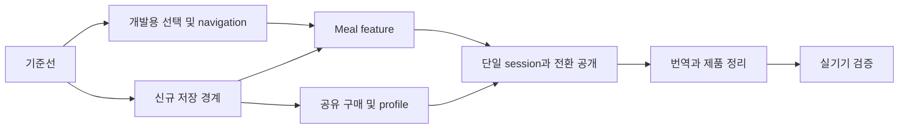

# 단계별 이행 계획

설계만 작성. T/Y 경로·VERIFIED 정의는 [01](01_ARCHITECTURE_KO.md), schema 계약은 [03](03_DATA_IAP_DESIGN_KO.md). 구현자는 단계 시작 시 HEAD와 기존 diff를 다시 확인해야 한다. 이번 문서는 기존 미커밋 도로 변경을 채택하거나 폐기하는 지시가 아니다.

## 1. 개정 범위와 의존성

파일명은 유지하지만 이제 **기능 이식·신규 저장 경계의 구현 계획**이다. 사전 출시 데이터 변환 작업은 없다. `LegacyTimeyImporter`, 과거 snapshot backup/marker/replay/복구 queue, 옛 설치 호환 PR는 폐기했다. 통합 앱의 새 데이터 recovery는 계속 필수다.

**P0 기준선 → P1 개발용 mode shell → P2 새 저장 경계 → P3 Meal 이식 → P4 공유 구매·프로필 → P5 단일 세션·모드 전환 공개 → P6 번역·제품 정리 → P7 검증**. P1은 fake 서비스로 UI를 검증하므로 DB 구현이 선행할 필요 없다. P3 파일 복사/compile은 P1 이후 가능하나 실제 저장 경로는 P2를 통과해야 한다. 개발용 진입은 release에서 제거되고 P5 전에는 실제 두 mode 실행을 일반 사용자에게 노출하지 않는다.

## 2. 현재→목표 매핑

| 현재 파일군 | 처리 | 목표/변경 이유 | 필수 검증 |
|---|---|---|---|
| T `lib/main.dart`, `lib/app.dart` | ADAPT | 새 DB open 및 최초 생성, shared owners, ModeSelectionScreen | cold/warm 각각 한 번의 의도된 route |
| T `lib/screens/home_screen.dart` | ADAPT | 모드 버튼, Daily meal 시작 제거, 전역 session conflict | 기존 builder/5개/3개 유지 |
| T `lib/screens/timer_screen.dart` | EXTRACT | session 생성·완료·save를 `shared/session/daily_session_adapter.dart`로 | timeEnded/needsMoreTime/선택 결과 동일 |
| T `lib/controllers/activity_timer_controller.dart` | KEEP+ADAPT | 계산 유지, root owner 주입 | pause·도착·wall clock 유지 |
| T `lib/screens/result_screen.dart` | ADAPT | coordinator/transaction gateway; 저장 뒤 cleanup 원자성 | sticker skip·pending 재시작 |
| T `lib/services/local_activity_progress_service.dart` | ADAPT | 보상 계산 유지, mode 고정 DB facade로 persistence 교체 | 연결 삭제·used goals·중복 지급 방지 |
| T `lib/services/active_activity_timer_session_store.dart` | REPLACE 내부 | public adapter는 점진 유지, global envelope writer 하나 | stale clear가 새 session 삭제 못함 |
| T `lib/services/local_settings_service.dart`, `local_recent_timer_service.dart`, `local_saved_timer_preset_service.dart` | ADAPT | 새 mode row / shared profile 분리 | 최초 defaults 한 번·통합 앱 최근 값 유지 |
| T `lib/services/vehicle_pack_purchase_controller.dart`, `iap_purchase_client.dart`, `local_purchase_entitlement_store.dart` | ADAPT | 단일 controller, request guard, restore delay, durable cache | purchase recovery 기존 suite + 지연 이벤트 |
| T `lib/catalogs/vehicle_catalog.dart`, `vehicle_unlock_catalog.dart`, `lib/models/vehicle.dart` | KEEP | 두 mode config adapter가 공유 | 무료/유료 분류·ID 동일 |
| T `lib/services/local_avatar_image_service.dart`, `lib/screens/avatar_setup_screen.dart` | ADAPT | profile 편집 공용, durable file path | 차량별 transform/취소/권한 거절 |
| Y `lib/screens/home_screen.dart`, `timer_screen.dart`, `result_screen.dart`, `meal_history_screen.dart`, `sticker_collection_screen.dart`, `reward_goal_screen.dart` | MOVE(COPY)+ADAPT | `T:lib/features/mealtime/screens/`에 복사; DI/import만 먼저 연결 | Y 대응 widget suite 복사 실행 |
| Y `lib/controllers/meal_timer_controller.dart`, `timer_active_session_controller.dart`, `timer_completion_flow_controller.dart`, `timer_lifecycle_controller.dart`, `motivation_cue_controller.dart` | MOVE(COPY)+ADAPT | `features/mealtime/controllers/`; session owner 분리 | 기존 Meal policy 유지 |
| Y `lib/models/meal_*.dart`, `active_meal_timer_session.dart` | MOVE(COPY) | feature/models; 현재 기능 필드 유지, 옛 설치 decoder 제외 | JSON round-trip |
| Y `lib/models/reward_goal.dart`, `reward_item.dart` | KEEP 복사본 우선 | Meal 모델 slot ID 차이를 숨기지 않음 | 필요 없는 모델 통합 금지 |
| Y `lib/services/local_meal_progress_service.dart`, `active_meal_timer_session_store.dart`, `local_settings_service.dart` | ADAPT | feature/services; namespace raw key 제거 | cross-mode read/write 0 |
| Y `lib/catalogs/meal_ingredient_catalog.dart`, `meal_course_catalog.dart`, `lib/config/meal_timer_policy.dart` | MOVE(COPY) | feature/catalogs, feature/config | 18종·최대 5선택·5~60 배포 정책 |
| Y `lib/widgets/road_view.dart`, `road_painter.dart`, `meal_ingredient_picker_sheet.dart`, `meal_message_card.dart` | MOVE(COPY) | feature/widgets, T 도로와 당장 통합하지 않음 | 도로 형상·marker crossing·회전 |
| Y `lib/l10n/` | MOVE(COPY)+ADAPT | feature/l10n, shared purchase/profile 문구 참조 | 5개 locale interface 누락 0 |
| Y `lib/main.dart`, `lib/app.dart`, 구매 infrastructure, `navigation/app_route_observer.dart` | RETIRE(통합 대상에서 제외) | T equivalents만 사용 | root·listener·observer 각 1개 |
| T `lib/catalogs/activity_catalog.dart` | ADAPT | `meal` 선택/실행/전용 호환 lookup 제거 | 통합 앱 Daily meal 생성0 |
| 양쪽 `lib/theme/`, 공통 차량/라이더 widget | KEEP T / adapter | byte 동일 또는 signature 확인된 부분만 재사용 | 양 mode layout 비교 |
| Y assets | EXTRACT 필요한 파일만 | ingredient 이미지 추가, 같은 hash 경로는 T 참조 | manifest 누락 0, 다른 hash 덮어쓰기 0 |
| T `pubspec.yaml`, `pubspec.lock` | 향후 ADAPT | SQLite 의존성 및 필요한 Meal 자산만(실제 구현 단계) | SDK 하한/빌드·license 검증 |

MOVE는 원본 Y를 변경하는 작업이 아니다. 테스트 `package:jy_yamyam/` import는 복사된 T feature 경로로 수정하고 동일 이름 테스트는 `test/features/mealtime/` 아래에 둔다. T 테스트 경로는 유지한다.

## 3. 작게 검증하는 PR 경계

| 단계/PR | 파일·범위 | 종료 기준·검증 | 되돌리기 | 복잡도·위험 |
|---|---|---|---|---|
| P0-a | 기존 test/ source 기준선, 현재 dirty files 별도 기록 | test/analyze 결과 및 기존 실패 구분, 보상/완료 정상 fixture 확보 | 문서·fixture만 | 낮음 / 기존 변경 덮어쓰기 금지 |
| P0-b | 현재 SDK/OS 하한, SQLite 호환 버전 검토 | dependency pin 후보 및 device DB 생성/transaction smoke | 미노출 실험 제거 가능 | 중 / 새 plugin build 회귀 |
| P1-a | app.dart/navigation/mode_selection_screen.dart | fake DI로 cold selector·warm 유지·origin home back 검증 | 개발용 route 제거 | 낮음~중 / 기존 popUntil 제거 대상 식별 |
| P1-b | 두 home 공통 header callback, Meal placeholder 개발용 진입 | 다중 home 누적0, production 두 mode 실행 미노출 | UI만 복귀 | 낮음 / 이 단계에서 active timer 지원을 주장하지 않음 |
| P2-a | shared/storage/local_state_database.dart | 두 테이블·최초 defaults·완료/삭제 저장 메서드, mode 격리·atomic commit·반복 open tests | consumer 연결 전 제거 가능 | 중 / SQL/validator |
| P2-b | T progress/settings/presets/entitlement/active store 저장 adapter | 기존 정책 fixture + 새 DB 실패 주입, 원본 preferences 읽기0 | 출시 전 개발 설치 명시 reset만; 배포 후 reset 금지 | 중~높음 / 저장 성공 표시 시점 |
| P3-a | Y 모델/catalog/필요 자산/l10n을 features/mealtime로 COPY | compile·asset resolver, 이름 충돌 alias | 미노출 feature 제거 | 중 / Y 원본 수정 금지 |
| P3-b | Meal progress/settings·home/timer/result/history/reward | P2 store에만 연결, 정상 Meal 흐름·타 mode 불변 | 개발 route off | 높음 / source 시간·보상 정책 보존 |
| P4-a | T profile/avatar/catalog 및 Meal config adapter | 공동 사진/이름·active snapshot 참조, 기본 차량 | 새 저장 데이터 유지한 UI 수정 | 중 / 파일-DB 경계 |
| P4-b | T purchase controller/client/cache/scope | single-flight·pending·늦은 restore·두 mode entitlement 일치 | 단일 owner 유지한 patch | 중~높음 / 실제 상품 복원 |
| P5-a | root ActiveSessionCoordinator·기존 두 controller owner 이전 | 화면 dispose와 시간 분리, new start conflict20회 active1 | 공개 기능 비활성화, 이미 생성한 session 복구 entry 유지 | 높음 / 수명 소유권 |
| P5-b | P2 저장 메서드와 coordinator의 completion/outcome·삭제/cancel·route 연결 | kill 경계 원자성·미확인 결과·24h 복구·ID stale clear 방지 | schema 유지한 수정판 | 높음 / 중복 보상·조용한 세션 삭제 |
| P5-c | home switch 공개, Daily meal 선택·모든 start 진입 차단 | P2~P5 전 gate 통과, 기록/목표 자기 mode만 표시 | 통합 데이터 삭제 없이 UI 제한 | 중 / 버튼 숨기기만으로 start 허용하지 않음 |
| P6 | 공용 ModeTextSet·5언어·parent gate·metadata | overflow0·목적/보상 문구 정확, 이관 안내 문구 없음 | UI/문구 수정 | 중 / 언어·iPad |
| P7 | test 및 실기기 restore/kill/update·성능 측정 | 05 mandatory gate, 미검증 release blocker 해소 | rollout 중단·통합 schema 지원 patch | 높음 / 시험과 실서비스 구분 |

각 PR은 구현한 저장 경계만 검증하고 앱 전체 재작성으로 확장하지 않는다. T controller 계산은 P5 이전 바꾸지 않으며 P3에서는 개발용 독립 시나리오만 실행한다. 기능의 정책·UI 변경과 저장 adapter 변경은 별 PR로 분리한다. 단계가 8개인 것은 제품 게이트를 명확히 하기 위한 것이며 이전 이관 PR의 작업량이 유지된다는 뜻은 아니다.

## 4. 제외 대상과 통합 후 보존

- 사전 출시 데이터 compatibility, importer, export/import, migration rollback, 옛 meal history/preset 표시를 구현하지 않는다.
- 초기화는 새 DB `onCreate` 한 번. 매 launch/version change의 clear/delete, SharedPreferences 전체 clear, 사진 디렉터리 전체 삭제 금지.
- 정상 unified v1 데이터는 새 앱의 후속 버전에서 유지한다. future schema 변경이 실제 생길 때 그 변경용 transaction/test만 추가한다.
- runtime은 새 저장소만 사용. P2부터 옛 fallback·journal 분기를 저장 경로에서 제거하며 이중 쓰기하지 않는다.
- IndexedStack에 두 실행 화면을 살려두지 않는다. 화면은 폐기 가능, session owner는 root에 유지한다.
- IAP wrapper는 Timey pin을 기준으로 하고 Y 버전을 통째로 덮지 않는다. 실제 store 권한 restore는 clean initialization 이후에도 필수다.

## 5. namespace 외 소스 충돌

| 대상 | 충돌 내용 | 최소 해결 |
|---|---|---|
| HomeScreen/TimerScreen/ResultScreen/SettingsScreen | 동일 공개 class 이름 | 각 library를 유지하고 root import에 `daily`/`meal` alias; 전역 rename 금지 |
| RewardGoal/RewardGoalSlot/RewardCatalog | 이름 같아도 slot id/decoder·호출 정책 차이 | Meal feature 모델 유지, 공유 asset ID만 동일 |
| AppTexts/AppTextBundle/TextSet | 구매 단수 purchase와 복수 purchases, activity vs meal interface | feature 별 import; 공용 widget은 명시 TextSet 전달 |
| appRouteObserver | top-level instance 두 개 | T observer 하나로 양 RouteAware subscribe |
| VehiclePackPurchaseController/State/Status | signature·enum·store 모델 상이 | Y type을 복사하지 않고 thin UI adapter |
| LocalSettingsService | config parameter 타입 다름, raw key 공통 | Meal 지역 서비스 유지, shared profile composite adapter |
| RoadView/TimerControlBar | 이름·marker type·lifecycle 의존 | 각 feature 내부 유지; 동일 theme만 공용 |
| TimerAudioService/orientation/wakelock | global resource 소유 충돌 | root lease와 visible route, 이전 lease async 완료가 새 lease 해제 못하게 generation token |
| assets/videos/splash_animation.mp4 | 같은 경로 다른 bytes | Timey splash 유지; Meal은 새 splash를 띄우지 않음 |
| assets/images/ingredients vs markers | 서로 다른 content/path | 필요한 ingredients만 manifest 추가, marker 그대로 유지 |
| Y imports package:jy_yamyam | 별도 package root 전제 | 복사된 파일 import를 T feature 경로로 수정, 별도 pub package 안 만듦 |

아래 부록은 공개 class/enum 이름의 정적 교집합이며 동등 구현이라는 뜻이 아니다.

| 중복 공개 타입 | T 선언 위치 | Y 선언 위치 |
|---|---|---|
| `AppBouncyButton` | `lib/widgets/app/app_bouncy_button.dart:13` | `lib/widgets/app/app_bouncy_button.dart:13` |
| `AppButtonSize` | `lib/widgets/app/app_bouncy_button.dart:11` | `lib/widgets/app/app_bouncy_button.dart:11` |
| `AppButtonVariant` | `lib/widgets/app/app_bouncy_button.dart:9` | `lib/widgets/app/app_bouncy_button.dart:9` |
| `AppCard` | `lib/widgets/app/app_card.dart:8` | `lib/widgets/app/app_card.dart:8` |
| `AppChoiceCard` | `lib/widgets/app/app_choice_card.dart:9` | `lib/widgets/app/app_choice_card.dart:9` |
| `AppColors` | `lib/theme/app_colors.dart:3` | `lib/theme/app_colors.dart:3` |
| `AppFeatureFlags` | `lib/config/app_feature_flags.dart:1` | `lib/config/app_feature_flags.dart:1` |
| `AppHelpSection` | `lib/widgets/app/app_help_sheet.dart:8` | `lib/widgets/app/app_help_sheet.dart:8` |
| `AppHelpSheet` | `lib/widgets/app/app_help_sheet.dart:42` | `lib/widgets/app/app_help_sheet.dart:42` |
| `AppHeroCard` | `lib/widgets/app/app_hero_card.dart:8` | `lib/widgets/app/app_hero_card.dart:8` |
| `AppMetricTile` | `lib/widgets/app/app_metric_tile.dart:8` | `lib/widgets/app/app_metric_tile.dart:8` |
| `AppMotion` | `lib/theme/app_motion.dart:3` | `lib/theme/app_motion.dart:3` |
| `AppRadius` | `lib/theme/app_radius.dart:3` | `lib/theme/app_radius.dart:3` |
| `AppSectionHeader` | `lib/widgets/app/app_section_header.dart:6` | `lib/widgets/app/app_section_header.dart:6` |
| `AppShadows` | `lib/theme/app_shadows.dart:5` | `lib/theme/app_shadows.dart:5` |
| `AppSpacing` | `lib/theme/app_spacing.dart:1` | `lib/theme/app_spacing.dart:1` |
| `AppTextBundle` | `lib/l10n/app_texts.dart:65` | `lib/l10n/app_texts.dart:65` |
| `AppTexts` | `lib/l10n/app_texts.dart:95` | `lib/l10n/app_texts.dart:95` |
| `AppTheme` | `lib/theme/app_theme.dart:6` | `lib/theme/app_theme.dart:6` |
| `AudioplayersMotivationAudioService` | `lib/services/motivation_audio_service.dart:25` | `lib/services/motivation_audio_service.dart:25` |
| `AudioplayersResultAudioService` | `lib/services/result_audio_service.dart:32` | `lib/services/result_audio_service.dart:32` |
| `AudioplayersTimerAudioService` | `lib/services/timer_audio_service.dart:94` | `lib/services/timer_audio_service.dart:94` |
| `AvatarCompositePreview` | `lib/widgets/avatar/avatar_composite_preview.dart:10` | `lib/widgets/avatar/avatar_composite_preview.dart:10` |
| `AvatarImageMode` | `lib/models/activity_timer_config.dart:6` | `lib/models/meal_timer_config.dart:3` |
| `AvatarImagePicker` | `lib/services/avatar_image_picker.dart:3` | `lib/services/avatar_image_picker.dart:3` |
| `AvatarPromptCatalog` | `lib/catalogs/avatar_prompt_catalog.dart:3` | `lib/catalogs/avatar_prompt_catalog.dart:3` |
| `AvatarSetupScreen` | `lib/screens/avatar_setup_screen.dart:27` | `lib/screens/avatar_setup_screen.dart:33` |
| `AvatarSetupTextSet` | `lib/l10n/text_sets.dart:152` | `lib/l10n/text_sets.dart:90` |
| `AvatarSetupTexts` | `lib/l10n/ko/avatar_setup.dart:5` | `lib/l10n/ko/avatar_setup.dart:5` |
| `ChildNameSetupScreen` | `lib/screens/child_name_setup_screen.dart:7` | `lib/screens/child_name_setup_screen.dart:8` |
| `CommonTextSet` | `lib/l10n/text_sets.dart:5` | `lib/l10n/text_sets.dart:3` |
| `CommonTexts` | `lib/l10n/ko/common.dart:5` | `lib/l10n/ko/common.dart:5` |
| `DefaultAvatarImagePicker` | `lib/services/avatar_image_picker.dart:7` | `lib/services/avatar_image_picker.dart:7` |
| `EnAvatarSetupTexts` | `lib/l10n/en/avatar_setup.dart:5` | `lib/l10n/en/avatar_setup.dart:5` |
| `EnCommonTexts` | `lib/l10n/en/common.dart:5` | `lib/l10n/en/common.dart:5` |
| `EnHomeTexts` | `lib/l10n/en/home.dart:6` | `lib/l10n/en/home.dart:5` |
| `EnPurchaseTexts` | `lib/l10n/en/purchase.dart:5` | `lib/l10n/en/purchases.dart:5` |
| `EnResultTexts` | `lib/l10n/en/result.dart:6` | `lib/l10n/en/result.dart:5` |
| `EnRewardTexts` | `lib/l10n/en/rewards.dart:5` | `lib/l10n/en/rewards.dart:5` |
| `EnSettingsTexts` | `lib/l10n/en/settings.dart:5` | `lib/l10n/en/settings.dart:5` |
| `EnTimerTexts` | `lib/l10n/en/timer.dart:5` | `lib/l10n/en/timer.dart:5` |
| `EnUserGuideTexts` | `lib/l10n/en/user_guide.dart:5` | `lib/l10n/en/user_guide.dart:5` |
| `EsAvatarSetupTexts` | `lib/l10n/es/avatar_setup.dart:5` | `lib/l10n/es/avatar_setup.dart:5` |
| `EsCommonTexts` | `lib/l10n/es/common.dart:5` | `lib/l10n/es/common.dart:5` |
| `EsHomeTexts` | `lib/l10n/es/home.dart:6` | `lib/l10n/es/home.dart:5` |
| `EsPurchaseTexts` | `lib/l10n/es/purchase.dart:5` | `lib/l10n/es/purchases.dart:5` |
| `EsResultTexts` | `lib/l10n/es/result.dart:6` | `lib/l10n/es/result.dart:5` |
| `EsRewardTexts` | `lib/l10n/es/rewards.dart:5` | `lib/l10n/es/rewards.dart:5` |
| `EsSettingsTexts` | `lib/l10n/es/settings.dart:5` | `lib/l10n/es/settings.dart:5` |
| `EsTimerTexts` | `lib/l10n/es/timer.dart:5` | `lib/l10n/es/timer.dart:5` |
| `EsUserGuideTexts` | `lib/l10n/es/user_guide.dart:5` | `lib/l10n/es/user_guide.dart:5` |
| `FlyingStickerAnimation` | `lib/widgets/flying_sticker_animation.dart:7` | `lib/widgets/flying_sticker_animation.dart:7` |
| `GoalStarPulse` | `lib/widgets/goal_star_pulse.dart:4` | `lib/widgets/goal_star_pulse.dart:4` |
| `HomeScreen` | `lib/screens/home_screen.dart:59` | `lib/screens/home_screen.dart:68` |
| `HomeTextSet` | `lib/l10n/text_sets.dart:73` | `lib/l10n/text_sets.dart:19` |
| `HomeTexts` | `lib/l10n/ko/home.dart:6` | `lib/l10n/ko/home.dart:5` |
| `IapPurchaseClient` | `lib/services/iap_purchase_client.dart:78` | `lib/services/iap_purchase_client.dart:3` |
| `InAppPurchaseClient` | `lib/services/iap_purchase_client.dart:96` | `lib/services/in_app_purchase_client.dart:10` |
| `JaAvatarSetupTexts` | `lib/l10n/ja/avatar_setup.dart:5` | `lib/l10n/ja/avatar_setup.dart:5` |
| `JaCommonTexts` | `lib/l10n/ja/common.dart:5` | `lib/l10n/ja/common.dart:5` |
| `JaHomeTexts` | `lib/l10n/ja/home.dart:6` | `lib/l10n/ja/home.dart:5` |
| `JaPurchaseTexts` | `lib/l10n/ja/purchase.dart:5` | `lib/l10n/ja/purchases.dart:5` |
| `JaResultTexts` | `lib/l10n/ja/result.dart:6` | `lib/l10n/ja/result.dart:5` |
| `JaRewardTexts` | `lib/l10n/ja/rewards.dart:5` | `lib/l10n/ja/rewards.dart:5` |
| `JaSettingsTexts` | `lib/l10n/ja/settings.dart:5` | `lib/l10n/ja/settings.dart:5` |
| `JaTimerTexts` | `lib/l10n/ja/timer.dart:5` | `lib/l10n/ja/timer.dart:5` |
| `JaUserGuideTexts` | `lib/l10n/ja/user_guide.dart:5` | `lib/l10n/ja/user_guide.dart:5` |
| `LocalAvatarImageService` | `lib/services/local_avatar_image_service.dart:8` | `lib/services/local_avatar_image_service.dart:8` |
| `LocalPurchaseEntitlementStore` | `lib/services/local_purchase_entitlement_store.dart:11` | `lib/services/local_purchase_entitlement_store.dart:5` |
| `LocalSettingsService` | `lib/services/local_settings_service.dart:7` | `lib/services/local_settings_service.dart:8` |
| `MotivationAssetCatalog` | `lib/catalogs/motivation_asset_catalog.dart:1` | `lib/catalogs/motivation_asset_catalog.dart:1` |
| `MotivationAudioService` | `lib/services/motivation_audio_service.dart:4` | `lib/services/motivation_audio_service.dart:4` |
| `MotivationVideoSchedule` | `lib/utils/motivation_video_schedule.dart:6` | `lib/utils/motivation_video_schedule.dart:6` |
| `MotorcycleWidget` | `lib/widgets/motorcycle_widget.dart:6` | `lib/widgets/motorcycle_widget.dart:6` |
| `OrientationService` | `lib/services/orientation_service.dart:3` | `lib/services/orientation_service.dart:3` |
| `PtBrAvatarSetupTexts` | `lib/l10n/pt_BR/avatar_setup.dart:5` | `lib/l10n/pt_BR/avatar_setup.dart:5` |
| `PtBrCommonTexts` | `lib/l10n/pt_BR/common.dart:5` | `lib/l10n/pt_BR/common.dart:5` |
| `PtBrHomeTexts` | `lib/l10n/pt_BR/home.dart:6` | `lib/l10n/pt_BR/home.dart:5` |
| `PtBrPurchaseTexts` | `lib/l10n/pt_BR/purchase.dart:5` | `lib/l10n/pt_BR/purchases.dart:5` |
| `PtBrResultTexts` | `lib/l10n/pt_BR/result.dart:6` | `lib/l10n/pt_BR/result.dart:5` |
| `PtBrRewardTexts` | `lib/l10n/pt_BR/rewards.dart:5` | `lib/l10n/pt_BR/rewards.dart:5` |
| `PtBrSettingsTexts` | `lib/l10n/pt_BR/settings.dart:5` | `lib/l10n/pt_BR/settings.dart:5` |
| `PtBrTimerTexts` | `lib/l10n/pt_BR/timer.dart:5` | `lib/l10n/pt_BR/timer.dart:5` |
| `PtBrUserGuideTexts` | `lib/l10n/pt_BR/user_guide.dart:5` | `lib/l10n/pt_BR/user_guide.dart:5` |
| `PurchaseEntitlement` | `lib/models/purchase_entitlement.dart:3` | `lib/models/purchase_entitlement.dart:7` |
| `PurchaseTextSet` | `lib/l10n/text_sets.dart:22` | `lib/l10n/text_sets.dart:231` |
| `PurchaseTexts` | `lib/l10n/ko/purchase.dart:5` | `lib/l10n/ko/purchases.dart:5` |
| `ResultAudioAssetCatalog` | `lib/catalogs/result_audio_asset_catalog.dart:1` | `lib/catalogs/result_audio_asset_catalog.dart:1` |
| `ResultAudioService` | `lib/services/result_audio_service.dart:6` | `lib/services/result_audio_service.dart:6` |
| `ResultScreen` | `lib/screens/result_screen.dart:116` | `lib/screens/result_screen.dart:107` |
| `ResultStickerAlbumButton` | `lib/widgets/result_sticker_album_button.dart:7` | `lib/widgets/result_sticker_album_button.dart:7` |
| `ResultTextSet` | `lib/l10n/text_sets.dart:369` | `lib/l10n/text_sets.dart:335` |
| `ResultTexts` | `lib/l10n/ko/result.dart:6` | `lib/l10n/ko/result.dart:5` |
| `RewardCatalog` | `lib/models/reward_item.dart:77` | `lib/models/reward_item.dart:77` |
| `RewardDefinition` | `lib/models/reward_item.dart:5` | `lib/models/reward_item.dart:5` |
| `RewardGoal` | `lib/models/reward_goal.dart:92` | `lib/models/reward_goal.dart:89` |
| `RewardGoalScreen` | `lib/screens/reward_goal_screen.dart:14` | `lib/screens/reward_goal_screen.dart:13` |
| `RewardGoalSlot` | `lib/models/reward_goal.dart:28` | `lib/models/reward_goal.dart:28` |
| `RewardGoalStatus` | `lib/models/reward_goal.dart:3` | `lib/models/reward_goal.dart:3` |
| `RewardInventoryItem` | `lib/models/reward_item.dart:41` | `lib/models/reward_item.dart:41` |
| `RewardStickerImage` | `lib/widgets/reward_sticker_image.dart:6` | `lib/widgets/reward_sticker_image.dart:6` |
| `RewardTextSet` | `lib/l10n/text_sets.dart:400` | `lib/l10n/text_sets.dart:360` |
| `RewardTexts` | `lib/l10n/ko/rewards.dart:5` | `lib/l10n/ko/rewards.dart:5` |
| `RewardType` | `lib/models/reward_item.dart:3` | `lib/models/reward_item.dart:3` |
| `RiderGuideBottomSheet` | `lib/widgets/avatar/rider_guide_bottom_sheet.dart:8` | `lib/widgets/avatar/rider_guide_bottom_sheet.dart:8` |
| `RoadCourseGeometry` | `lib/widgets/road_painter.dart:9` | `lib/widgets/road_painter.dart:9` |
| `RoadCourseVisualStyle` | `lib/widgets/road_painter.dart:314` | `lib/widgets/road_painter.dart:327` |
| `RoadMotivationVideoLayer` | `lib/widgets/road_view.dart:684` | `lib/widgets/road_view.dart:694` |
| `RoadPainter` | `lib/widgets/road_painter.dart:425` | `lib/widgets/road_painter.dart:438` |
| `RoadVehicleLayer` | `lib/widgets/road_view.dart:754` | `lib/widgets/road_view.dart:764` |
| `RoadView` | `lib/widgets/road_view.dart:21` | `lib/widgets/road_view.dart:21` |
| `ScreenAwakeService` | `lib/services/screen_awake_service.dart:3` | `lib/services/screen_awake_service.dart:3` |
| `SettingsScreen` | `lib/screens/settings_screen.dart:67` | `lib/screens/settings_screen.dart:59` |
| `SettingsTextSet` | `lib/l10n/text_sets.dart:256` | `lib/l10n/text_sets.dart:187` |
| `SettingsTexts` | `lib/l10n/ko/settings.dart:5` | `lib/l10n/ko/settings.dart:5` |
| `SplashScreen` | `lib/screens/splash_screen.dart:8` | `lib/screens/splash_screen.dart:8` |
| `StickerCollectionScreen` | `lib/screens/sticker_collection_screen.dart:14` | `lib/screens/sticker_collection_screen.dart:14` |
| `SystemOrientationService` | `lib/services/orientation_service.dart:9` | `lib/services/orientation_service.dart:9` |
| `TimerAudioAssetCatalog` | `lib/catalogs/timer_audio_asset_catalog.dart:1` | `lib/catalogs/timer_audio_asset_catalog.dart:1` |
| `TimerAudioService` | `lib/services/timer_audio_service.dart:8` | `lib/services/timer_audio_service.dart:8` |
| `TimerControlBar` | `lib/widgets/timer_control_bar.dart:7` | `lib/widgets/timer_control_bar.dart:7` |
| `TimerScreen` | `lib/screens/timer_screen.dart:166` | `lib/screens/timer_screen.dart:183` |
| `TimerTextSet` | `lib/l10n/text_sets.dart:332` | `lib/l10n/text_sets.dart:301` |
| `TimerTexts` | `lib/l10n/ko/timer.dart:5` | `lib/l10n/ko/timer.dart:5` |
| `UserGuideScreen` | `lib/screens/user_guide_screen.dart:9` | `lib/screens/user_guide_screen.dart:9` |
| `UserGuideTextSet` | `lib/l10n/text_sets.dart:305` | `lib/l10n/text_sets.dart:274` |
| `UserGuideTexts` | `lib/l10n/ko/user_guide.dart:5` | `lib/l10n/ko/user_guide.dart:5` |
| `VehicleAvatarConfig` | `lib/models/activity_timer_config.dart:11` | `lib/models/meal_timer_config.dart:10` |
| `VehicleAvatarPresentation` | `lib/models/vehicle_avatar_presentation.dart:5` | `lib/models/vehicle_avatar_presentation.dart:5` |
| `VehicleAvatarSlot` | `lib/models/vehicle.dart:1` | `lib/models/vehicle.dart:1` |
| `VehicleCatalog` | `lib/catalogs/vehicle_catalog.dart:3` | `lib/catalogs/vehicle_catalog.dart:3` |
| `VehicleCourseKind` | `lib/models/vehicle.dart:31` | `lib/models/vehicle.dart:31` |
| `VehicleDefinition` | `lib/models/vehicle.dart:33` | `lib/models/vehicle.dart:33` |
| `VehiclePackPurchaseController` | `lib/services/vehicle_pack_purchase_controller.dart:72` | `lib/controllers/vehicle_pack_purchase_controller.dart:66` |
| `VehiclePackPurchaseSheet` | `lib/widgets/purchase/vehicle_pack_purchase_sheet.dart:33` | `lib/widgets/purchases/vehicle_pack_purchase_sheet.dart:37` |
| `VehiclePackPurchaseState` | `lib/services/vehicle_pack_purchase_controller.dart:26` | `lib/controllers/vehicle_pack_purchase_controller.dart:26` |
| `VehiclePackPurchaseStatus` | `lib/services/vehicle_pack_purchase_controller.dart:10` | `lib/controllers/vehicle_pack_purchase_controller.dart:11` |
| `VehicleRoadAnchorOffset` | `lib/models/vehicle.dart:15` | `lib/models/vehicle.dart:15` |
| `VehicleSelectionCard` | `lib/widgets/vehicle_selection_card.dart:16` | `lib/widgets/vehicle_selection_card.dart:15` |
| `VehicleUnlockCatalog` | `lib/catalogs/vehicle_unlock_catalog.dart:6` | `lib/catalogs/vehicle_unlock_catalog.dart:5` |
| `VehicleWidget` | `lib/widgets/vehicle_widget.dart:13` | `lib/widgets/vehicle_widget.dart:13` |
| `WakelockScreenAwakeService` | `lib/services/screen_awake_service.dart:7` | `lib/services/screen_awake_service.dart:7` |

## 6. 유지하는 기존 리뷰의 안전장치

- P5: 양 home의 24h 자동 session clear와 Y home의 직접 pendingCompletion 기록/clear를 coordinator로 옮긴다. 이는 옛 데이터 이관이 아니라 새 통합 session 보존 작업이다.
- `session_outcomes`의 result/config/acknowledged_at과 삭제/취소 상태를 보존한다. 별도 operations ledger는 만들지 않는다.
- T/Y result `_goHome` 및 Y timer deleted-result cleanup의 `popUntil(route.isFirst)`는 origin home callback으로 바꾼다. selector banner도 home+result stack을 만든다.
- Meal 확인 전 arrived와 확인 후 pendingCompletion은 다른 상태다. 후자는 현재 unified session에서 확정 의도로 retry하며 재확인·재지급하지 않는다.

P2의 완료/삭제 transaction 메서드는 source 도메인 fixture와 저장 adapter 단위로 먼저 검증한다. P2-b에서는 기존 화면이 사용하는 active store API를 새 단일 session row에 연결하되 controller 수명은 아직 바꾸지 않는다. P5는 이 원자 저장 계약을 새 coordinator와 실제 화면 수명에 연결하는 작업이다. 따라서 P2 검증을 P5 구현에 의존시키지 않는다. Meal의 실제 service/UI 회귀는 P3 이후 실행한다.
