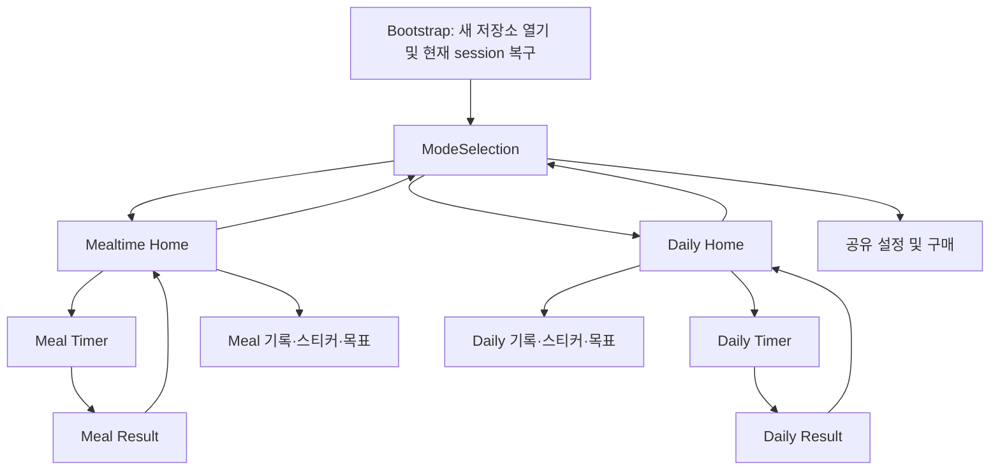
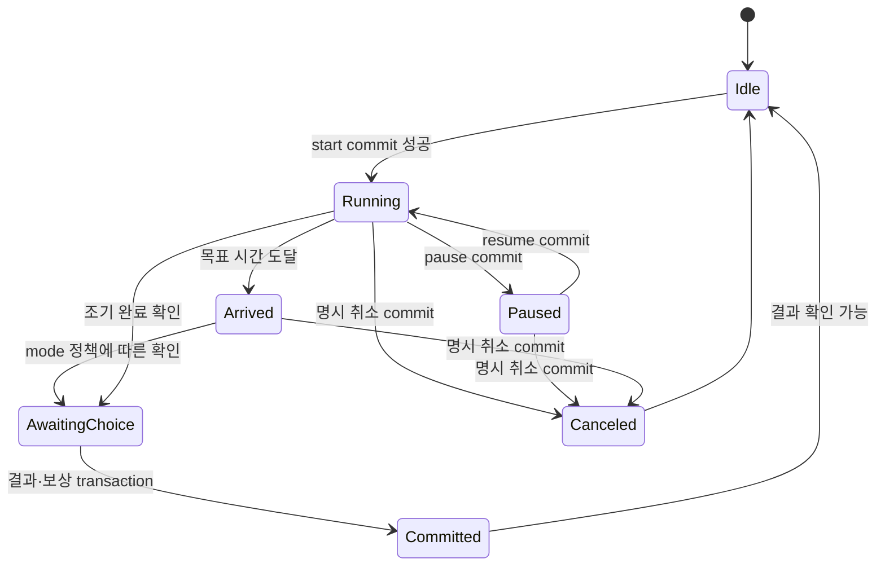

# UX·내비게이션·수명주기 설계

기존 구현 근거는 [01](01_ARCHITECTURE_KO.md), 새 행동은 PROPOSED다. 이미지나 mockup은 생성하지 않았다.

## 1. 매 실행의 정의

Fresh launch는 새 Dart root/app bootstrap이 만들어지는 실행이다. 콜드 실행과 OS 프로세스 종료 후 재생성을 포함한다. 새 앱 창/engine이 생기면 동일 원칙을 적용하되 현재 모바일 단일 app root가 기본 가정이다. 단순 `resumed`, 전화/권한/구매창 복귀, home 버튼 후 복귀는 fresh launch가 아니다. hot reload도 제품 launch가 아니다.

| 진입 상황 | 화면 | 세션 처리 |
|---|---|---|
| 신규 설치 cold | 짧은 기존 splash 후 선택 | mode 선택 후 필요한 첫 안내·이름 설정 한 번 |
| 통합 앱 재실행 cold | 선택 | 마지막 mode 자동 재진입 금지, 이름/온보딩 재요구 금지 |
| background→resumed | 이전 route | clock 갱신, 숨은 시간 반영, 구매 recover; 선택 화면 강제 push 금지 |
| 프로세스 종료 후 재실행 | 선택 + 진행/결과 확인 banner | DB 복구 완료 후 새 timer 시작 가능; session 자동 삭제 금지 |
| timer에서 home/선택으로 이동 | origin home 또는 selector | 시간이 흐르고 pause 상태면 pause 유지 |
| 결과에서 home | 결과 원래 mode home | commit된 결과 다시 award 금지 |
| OS가 route 복원을 시도 | fresh 선택 우선 | route는 덮어쓸 수 있으나 durable session/result는 보존 |

Flutter lifecycle 통지는 모든 상태를 반드시 전달하지 않으며 강제 종료 전 통지가 없을 수 있다. 따라서 `paused`에만 저장하면 안 된다. start/pause/resume/완료 선택마다 먼저 commit하며 route 변경이 타이머 취소를 의미하지 않는다. [Flutter AppLifecycleState](https://api.flutter.dev/flutter/dart-ui/AppLifecycleState.html).

## 2. 선택 화면 wireframe

```text
Timey Rider                         [보호자 설정]
오늘은 어떤 시간을 함께할까요?

[기존 음식/라이더 그림]
식사 시간
식재료를 고르고 즐겁게 식사해요.       [선택]

[기존 활동 마커/차량 그림]
일상 활동
양치, 정리, 독서와 놀이 시간을 함께해요. [선택]

[있을 때만: 식사 타이머 진행 중 · 12분 남음  돌아가기]
[있을 때만: 일상 활동 결과 확인이 필요해요    결과 확인]
```

기존 palette/card/rider 이미지를 사용한다. portrait는 세로 두 카드, iPad/충분한 폭은 동일 읽기 순서의 2열; 높이 부족 시 scroll. 숨은 mode를 암시하는 색상만으로 구분하지 않고 제목/아이콘을 함께 둔다. 모드 선택에는 parent gate를 넣지 않는다. 필수 이름 입력은 첫 mode 선택 후 기존 screen을 공용 profile 저장으로 연결하고 다른 mode에서 반복하지 않는다. 통합 앱이 저장한 온보딩 flag를 존중하며 장문의 새 통합 onboarding을 추가하지 않는다.

## 3. 전환 대안 평가

| 대안 | 장점 | 현재 구조 위험 | 결론 |
|---|---|---|---|
| A 헤더 segmented control | 바로 mode 선택 가능 | Y home의 grid/Timey builder header 공간 경쟁, deep stack·state 보존 기대를 만듦 | 이번에는 미채택 |
| B 항상 보이는 공용 switcher | deep screen에서도 즉시 전환 | timer/result/구매 modal 안에 노출하면 저장·orientation 회귀 큼 | home header에 한정 채택 |
| C 공용 선택 화면 복귀 | 기존 Navigator와 잘 맞음, 목적 설명 재사용 | selector 거쳐 목적 mode 선택까지 2 tap | B의 home 버튼과 결합 |

양 home 헤더의 `[식사 시간 ▾]` 또는 `[일상 활동 ▾]` + 보이는 `모드 변경` 버튼을 탭하면 선택 화면으로 바로 간다. back 여러 번은 필요 없다. 선택에서 목적 mode를 한 번 더 탭한다. 이는 persistent bottom shell 도입 없이 동일한 상호작용을 제공한다.

## 4. route 구조와 back



단일 Navigator의 root를 selector로 둔다. home 전환 시 selector 위 stack을 정리한 뒤 새 home 한 장을 push한다. 두 home을 계속 쌓지 않는다. global modal이 있으면 먼저 정상 dismiss 경로를 실행한다. 전환 command는 직렬화하고 generation token으로 늦은 route callback을 무시한다.

Deep screen back은 같은 mode home, home back은 selector, selector Android back은 OS 종료 동작이다. iOS back swipe도 동일한 승인/저장 경계를 통과해야 한다. timer에는 `홈으로`를 제공하고 첫 이탈에 “타이머는 계속 진행돼요” 안내. 이탈 자체는 취소 확인이 아니며, cancel은 별도 명시 버튼으로만 수행한다. 저장 실패 시 성공한 것처럼 화면을 닫지 않는다. 결과 저장/선택 미완료 back은 선택 미완료 상태를 durable하게 남기고 home banner로 접근 가능하게 한다.

공유 settings는 이름/라이더/차량팩/복원/법적 안내를 한 곳에서 제공한다. 각 home에서 열면 현재 mode의 timer sound/remaining time/awake/motivation 설정 section을 별도로 표시한다. selector에서는 mode별 설정으로 들어가는 두 명시 entry를 둔다. history/sticker/reward는 각 mode 화면과 서비스만 연결하고 “식사 스티커”, “일상 활동 스티커”를 제목에 붙인다. 기존 parent gate를 구매/외부 링크 경계에 유지하며 history·목표 편집의 기존 gate 유무는 원 UI 테스트로 보존한다.

## 5. 활성 세션 계약



실제 `app_state[session].active.phase`는 running/paused/arrived/awaitingConfirmation/awaitingStickerChoice/committing이다. `Committed`/`Canceled`는 durable outcome이며 active slot을 비운다. coordinator는 slot을 비워도 결과 복구 링크를 위해 DB의 status=completed이고 acknowledged_at이 NULL인 미확인 outcome 목록을 조회한다. 완료 저장 transaction 중에는 start를 serialize한다. 아직 commit되지 않은 pending 결과가 있으면 새 실행보다 기존 확인을 우선해 유실 가능성을 줄인다. 이미 commit된 미확인 outcome은 active slot을 점유하지 않으므로 새 실행을 막지 않으며, 확인 전까지 별도 목록에 남는다.

시작 충돌 dialog:
```text
식사 타이머가 진행 중이에요.
새 타이머를 시작하려면 먼저 진행 중인 시간을 정리해 주세요.
[진행 중인 타이머로 돌아가기]
[현재 타이머를 취소하고 새로 시작]
[여기에 머무르기]
```

돌아가기는 originating mode home+timer를 복원하며 새 session을 만들지 않는다. 취소 후 시작에는 명시 확인을 추가한다. 취소는 스티커/성공 history 없이 canceled outcome으로 남긴다. old cancel+new active를 한 DB transaction으로 교체한다. 실패하면 이전 timer 유지, commit 응답이 불명확하면 row를 다시 읽어 현재 session을 표시한다. 두 단계 저장으로 이전 실행만 취소한 상태를 만들지 않는다.

완료 선택 대기 상태는 “결과 확인하기 / 여기에 머무르기”만 보여준다. 이미 확정된 결과를 새 시작 때문에 cancel로 바꾸지 않는다. 여러 start 호출은 coordinator mutex와 단일 session row 및 transaction 조건로 한 건만 성공한다. sessionId+revision이 다른 오래된 pause/clear/complete는 거절한다.

## 6. 화면 밖의 시간·알람

VERIFIED: 두 controller는 wall clock 기반이고 화면 dispose가 controller를 dispose한다. T 도착 시 ticker 중지, Y는 계속하며 T 도착 확정 actualDuration은 목표 시간으로 고정된다. 이를 화면 이동과 독립된 mode adapter로 추출해야 한다. 시간 policy 자체를 공통화하지 않는다.

화면이 사라지면 렌더 ticker/video/BGM을 중지하고 coordinator는 clock/가벼운 도착 deadline만 유지한다. 돌아올 때 원 config·elapsed·pause·milestone에서 UI를 재구성한다. 앱이 background면 OS가 Dart timer를 멈춰도 복귀 시 wall clock으로 도착 판정한다. 수동 시계 뒤로 이동은 음수 clamp, 앞으로 큰 이동은 도착 확인으로 처리하고 자동 보상은 하지 않는다. 타이머 동작 시각의 clock 변경은 별도 fake-clock test로 고정한다.

다른 home/selector가 보일 때 시간 도달: global banner “식사 시간이 끝났어요. 결과를 확인해 주세요”; 현재 화면을 강제로 덮는 result push 금지. foreground에서는 active mode의 sound 설정에 따른 단일 alarm lease를 허용하고 배너의 확인/음소거로 정지한다. 완료 확인까지 스티커를 지급하지 않는다. Daily timeEnded도 원래 도착 행동을 복원해 결과 판단한다. warm resume 시 이미 acknowledge된 알람은 다시 울리지 않는다. `alarmAcknowledged`는 session payload로 저장한다.

현재 `timer_audio_service.dart`는 audioplayers 앱 내 alarm이며 native notification scheduling을 확인하지 못했다(알림 dependency 없음). 통합 1차도 background/종료 상태 알람을 보장한다고 표시하지 않는다. 강제 종료 상태의 정확한 알림이 필요하면 권한·예약 취소·재시작 테스트가 필요한 별도 기능이며 제품 결정 사항이다.

orientation/awake는 **현재 보이는 화면**이 소유한다. timer→home은 portrait/awake off, timer 복귀는 기존 meal flow orientations/설정 적용. 회전은 pause나 새 session의 원인이 아니다. 이전 screen dispose의 비동기 lockPortrait/awake off가 새 timer lease를 해제하지 않도록 generation 비교한다.

## 7. 구매 중 전환·복구 메시지

native 구매창 표시 중 switch 불가; 복귀 시 mode selector를 새로 만들지 않는다. 장기 pending에서는 switch 허용, 버튼은 “구매 확인 중”이고 재구매 막음. restore 중 화면 이동해도 root subscription 유지; 알림은 현재 route에서 한 번만 표시한다.

| 상황 | 한국어 문구 초안 | 행동 |
|---|---|---|
| 복구 가능 | “진행하던 식사 타이머가 있어요.” | 돌아가기/다른 mode 둘 다 가능 |
| 결과 대기 | “일상 활동 결과를 확인해 주세요.” | 결과 확인, 중복 완료 금지 |
| 저장 오류 | “기록을 저장하지 못했어요. 다시 시도해 주세요.” | retry, pending 유지 |
| 손상된 snapshot | “진행 정보를 읽지 못했어요. 기존 데이터는 보관했어요.” | 복구/보호자 안내, 자동 신규 시작 차단 |
| 복원 지연 | “구매 확인이 아직 끝나지 않았어요.” | 재확인, 보유 권한 유지 |

## 8. 다국어

VERIFIED: `lib/l10n/app_texts.dart:95`와 Y 대응 파일은 Dart TextSet 번들 방식이며 en/ko/ja/es/pt_BR를 지원한다. ARB 재생성·새 localization 프레임워크는 필요 없다. 기존 Daily 번들 유지, Meal 번들은 feature-local import alias, 공용 `ModeTextSet`/shared purchase/profile 번들을 추가한다. Meal widget에서 Daily `AppTexts`를 실수로 import하는 lint/compile test를 둔다.

공용 string 식별자: `modeSelectionTitle`, `mealtimeModeTitle`, `dailyModeTitle`, `switchMode`, `activeTimerReturn`, `timerConflictCancelAndStart`, `pendingResultReview`, `storageRetry`. 언어별 key 존재와 placeholder 수를 테스트한다. terminology는 식사/일상 활동/각 mode 스티커를 구별하고 스토어 설명도 동일 용어로 맞춘다. 영어 `Mealtime`, `Daily Activities`를 포함해 나머지 언어 문구는 직역 대신 기존 어투를 기준으로 원어민 검수한다. 일본어·스페인어·pt_BR 긴 버튼, 200% text scale, screen reader focus, 음식/활동 아이콘 대체 텍스트를 확인한다.

## 9. adapter 추출 시 주의할 코드 경계

T `lib/screens/timer_screen.dart:1350` 이후 pending 저장, `:1418` snapshot과 Y `lib/controllers/timer_active_session_controller.dart:39` snapshot, `lib/screens/timer_screen.dart:1080` completion 보존을 coordinator 경계로 옮긴다. 초기 PR은 계산 함수/모델을 유지하고 화면 constructor에 coordinator session handle을 주입한다. 화면 dispose는 animation/audio만 정리하고 실행 controller를 dispose하지 않는다. 최종 완료/cancel 또는 root dispose만 controller를 정리한다.

기존 16ms controller ticker를 계속 돌려 놓고 UI만 감추지 않는다. `setPresentationActive(false)` 같은 adapter 내부 경로로 frame ticker를 중지하고 도착 deadline을 root scheduler에 맡긴다. 화면 재진입/resumed는 `refreshFromClock` 후 필요한 ticker를 재개한다. Meal의 도착 후 실제 elapsed 증가, Daily 도착 시 고정 actualDuration 정책은 controller snapshot/adapter가 보존한다. pause/resume/start commit 실패 시 새 상태를 성공 UI로 먼저 노출하지 않는다.


## 10. 기존 navigation/자동 정리의 필수 교체

VERIFIED: T `lib/screens/result_screen.dart:471`, Y `lib/screens/result_screen.dart:281`의 홈 이동과 Y `lib/screens/timer_screen.dart:1147` 삭제된 결과 정리는 `popUntil(route.isFirst)`를 쓴다. root를 selector로 바꾸면 origin home을 지나 selector까지 pop하므로 그대로 이식하지 않는다. `ModeNavigationController.returnToHome(originMode)`로 교체한다. 해당 mode home route가 있으면 명시 route metadata의 mode/home predicate까지 pop, 없으면 selector 위 stack을 `origin home`으로 재구성한다. selector banner에서 결과를 열 때도 `[selector, origin home, result]`를 구성하여 back이 origin home으로 돌아가게 한다. route.isFirst는 selector 복귀 의도에만 사용한다.

VERIFIED: T `lib/screens/home_screen.dart:55,154,1027`, Y 동일 파일 `:50,174,1000`에 24시간 경과 session 자동 clear가 있다. 통합에서는 두 home의 `_isStaleActiveSession`에 의한 clear와 직접 pendingCompletion commit/clear를 제거하고 coordinator 조회로 교체한다. 오래되었거나 시계가 바뀐 session은 “이전 타이머를 확인해 주세요”로 남긴다. pause/arrived 구분을 보존하고 명시 확인 또는 취소만으로 해제한다. 사용자가 이미 확정한 Meal pendingCompletion은 재확인 요구 없이 03의 확정 결과 복구 경로를 따른다.

## 11. clean initialization의 사용자 경험

사전 출시 설치의 설정·이름·사진·타이머·프리셋·기록을 이어받지 않는다. 별도 데이터 이전 wizard나 옛 식사 preset badge는 없다. 통합 앱 첫 실행에서 선택→필요한 최초 안내/이름 설정으로 시작한다. 이후 재실행에서는 통합 앱이 저장한 상태를 유지하고 선택 화면만 다시 보여준다. “처음 실행”은 앱 버전이나 launch 횟수가 아니라 새 저장소 최초 생성 상태로 판단한다.

Daily는 양치·놀이·정리·독서·기타만 선택/실행할 수 있다. 식사는 mode 선택으로 안내한다. header/button뿐 아니라 builder/preset/recent/start service validator 모두 `meal`을 Daily 입력으로 받지 않는다. 옛 history/meal 모델 lookup을 표시하기 위한 예외 경로는 만들지 않는다. 통합 앱에서 새로 만드는 Daily preset5/favorite3/recent는 계속 지원한다.

clean local cache 이후에도 공유 구매 화면에 “구매 복원”이 있다. 실제 Timey 구매자는 store를 통해 양 mode에 다시 entitlement를 적용할 수 있다. 별도 Y 앱 구매가 자동 이전된다고 안내하지 않는다. 정상적인 통합 앱 재실행/업데이트는 local entitlement cache와 모든 신규 데이터를 초기화하지 않는다.
